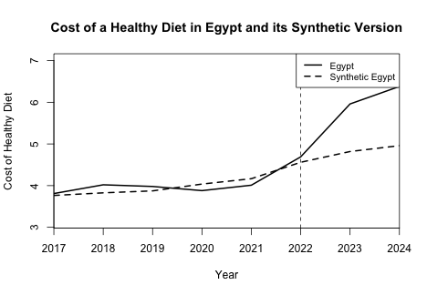
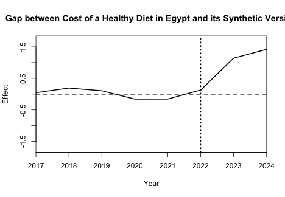
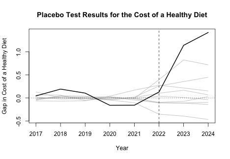

# Russia–Ukraine War and the Cost of a Healthy Diet in Egypt

## Overview

The 2022 Russia–Ukraine war disrupted global grain markets, putting pressure on food prices worldwide. 
This was particularly relevant for Egypt, where wheat and bread are staples and wheat imports play an 
important role in the food system. Rising global grain prices, combined with domestic inflation and 
currency depreciation, may have increased the cost of food in Egypt.

This project uses the Synthetic Control Method to evaluate how Egypt's cost of a healthy diet evolved following 
the onset of the Russia–Ukraine war in 2022, relative to a synthetic counterfactual constructed from comparable 
countries. Using data from the World Bank, I construct a synthetic Egypt from 11 donor countries and compare its 
estimated trajectory with Egypt's observed diet costs from 2022 to 2024.

The average post-treatment gap was $0.897 per person per day, approximately 18.40% above the synthetic counterfactual. 
Placebo and leave-one-out analyses were used to assess the relative magnitude and robustness of the estimated divergence.

## Data Sources

The analysis uses data from the World Bank's two datasets:

- **[Food Prices for Nutrition (FPN)](https://datacatalog.worldbank.org/search/dataset/0061222/food-prices-for-nutrition-fpn):** Country-level data on the cost of a healthy diet.
- **[World Development Indicators (WDI)](https://datacatalog.worldbank.org/search/dataset/0037712/world-development-indicators):** Country-level socioeconomic and development indicators.

## Countries and Variables

### Countries

- **Treated country:** Egypt
- **Donor pool:** Brazil, Colombia, India, Indonesia, Kazakhstan, Malaysia, Mexico, Peru, the Philippines, South Africa, and Thailand.

### Variables

- **Outcome variable:** Cost of a healthy diet (per person per day, PPP USD).
- **Predictor variables:**
  - GDP per capita
  - Inflation (%)
  - Exchange rate
  - Agriculture, forestry, and fishing value added (% of GDP)
  - Trade (% of GDP)
  - Total population
  - Urban population (%)
  - Lagged cost of a healthy diet (per person per day, PPP USD)

### Study Period

- **Pre-treatment period:** 2017–2021
- **Post-treatment period:** 2022–2024, with 2022 designated as the treatment year corresponding to the onset of the Russia–Ukraine war.

## Methodology

This study uses the Synthetic Control Method (SCM), which constructs a weighted combination of comparison countries 
to estimate what would have happened in the absence of an intervention or shock. The method creates a synthetic version 
of Egypt that closely matches Egypt's pre-treatment trajectory in the cost of a healthy diet, providing a counterfactual 
for comparison after the onset of the Russia–Ukraine war.

Egypt is the treated country, and the donor pool consists of 11 countries with comparable economic and demographic characteristics. 
Egypt was chosen because of its reliance on imported wheat and cereals. The donor countries were used to construct a synthetic 
Egypt that approximates the trajectory of Egypt's cost of a healthy diet in the absence of the shock.

The model is fitted using the pre-treatment period (2017–2021), with 2022 designated as the start of the treatment 
period. The observed cost of a healthy diet in Egypt is then compared with the estimated synthetic counterfactual 
for 2022–2024. The difference between the two trajectories represents the estimated divergence relative to the 
synthetic control, which may reflect the effects of the war as well as other concurrent economic factors.

## Results

Synthetic Egypt was constructed as a weighted combination of donor countries to match Egypt's pre-treatment trajectory. 
Indonesia received the largest weight (64.5%), followed by Thailand (29.2%), South Africa (6.0%), and the Philippines (0.3%). 
The remaining countries received zero weight.

The synthetic control provides an estimate of how Egypt's cost of a healthy diet might have evolved in the absence of the shock. 
The credibility of this counterfactual depends in part on how closely synthetic Egypt matches Egypt during the pre-treatment period.

RMSPE measures the difference between the observed outcome and the synthetic control over a given period. 
The pre-treatment RMSPE was 0.141, and the post-to-pre RMSPE ratio was 7.47. This indicates that the post-treatment 
prediction error was substantially larger than the pre-treatment error.

### Actual vs. Synthetic Egypt


During the pre-treatment period (2017–2021), Egypt's actual cost of a healthy diet followed a trajectory similar to 
synthetic Egypt. After 2022, the two series diverged, with Egypt's actual cost increasing more rapidly and remaining 
above the synthetic counterfactual through 2024.

### Estimated Post-Treatment Difference
During 2022–2024, the average gap between Egypt's actual cost of a healthy diet and its synthetic counterfactual was 
$0.897 per person per day, approximately 18.40% higher than the synthetic estimate.

### Gap Plot


The gap plot shows the difference between Egypt's actual cost and its synthetic counterfactual. 
The gap was relatively small before 2022 and became positive and widened afterward, indicating higher 
diet costs in Egypt relative to the synthetic control.

### Placebo Analysis


A placebo test was conducted to assess how Egypt's estimated gap compares with those of other countries. 
Each country in the donor pool was sequentially reassigned as the treated country. For each placebo country, 
a synthetic control was constructed using the remaining countries, and the gap between the observed and synthetic outcomes was calculated.

To improve comparability, placebo units with pre-treatment MSE more than five times that of Egypt were excluded 
from the placebo distribution. These units were Kazakhstan and Thailand. This restriction focuses the comparison 
on placebo units with a reasonably good pre-treatment fit.

Compared with Egypt, all remaining placebo countries exhibit smaller post-treatment gaps relative to their 
respective synthetic controls. This suggests that Egypt experienced a relatively large divergence in the cost 
of a healthy diet compared with its synthetic control.

## Robustness Checks

### Leave-One-Out Sensitivity Analysis

A leave-one-out sensitivity analysis was conducted by sequentially removing each of the four donor countries with 
a positive weight in the baseline synthetic control and re-estimating the model.
Across all specifications, the post-to-pre RMSPE ratio remained substantially greater than one, indicating that the post-treatment 
discrepancy was consistently larger than the pre-treatment discrepancy.

Excluding Thailand produced the largest change in the ratio, reducing it from 7.47 in the baseline model to 5.53. 
The ratio remained substantially greater than one, suggesting that the post-treatment divergence was not driven solely by 
Thailand. Excluding Thailand also increased the pre-treatment RMSPE from 0.141 to 0.222, indicating that Thailand played 
an important role in matching Egypt's pre-treatment trajectory.

## Potential Limitations

- Small donor pool: The donor pool consists of 11 countries, with most of the synthetic control's weight assigned to 
Indonesia and Thailand. This limits the range of potential comparison countries and makes the counterfactual more 
dependent on these two countries.
- Limited pre-treatment period: The pre-treatment period covers only 2017–2021, making it difficult to assess whether 
the relationship between Egypt and synthetic Egypt would have continued after 2021 in the absence of the shock.
- Potential confounding factors: The Russia–Ukraine war coincided with other economic changes, including inflation, 
exchange-rate changes, and other economic shocks, which may also have contributed to the observed divergence.
- Potential spillover effects: The war affected global food and energy markets, potentially influencing donor 
countries as well as Egypt. These spillovers may weaken the validity of the synthetic control as a counterfactual.

## Conclusion

Using the Synthetic Control Method, this study finds that Egypt's cost of a healthy diet rose above 
its synthetic counterfactual following the onset of the Russia–Ukraine war. The divergence remained substantial 
in placebo and leave-one-out analyses, suggesting that Egypt's increase was relatively large compared with the 
experience of similar countries. However, the results should be interpreted in light of potential confounding 
factors and spillover effects, and the divergence cannot be attributed solely to the Russia–Ukraine war.

## Repository Structure

```text
Russia-Ukraine-War-Diet-Cost/
├── README.md
├── egypt-healthy-diet-synthetic-control.Rmd
├── egypt-healthy-diet-synthetic-control.pdf
├── Russia-Ukraine-War-Diet-Cost.Rproj
├── data/
│   ├── price_of_healthy_diet_clean.csv
│   └── world_bank_indicators.csv
├── figures/
│   ├── actual-vs-synthetic-egypt.png
│   ├── gap-plot.png
│   └── placebo-plot.png
└── .gitignore
```

